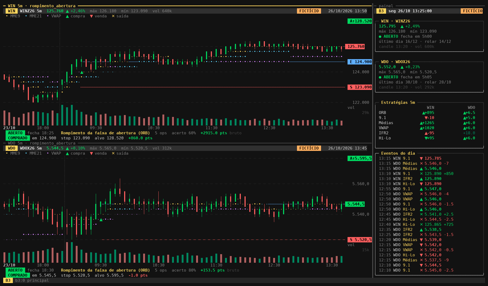
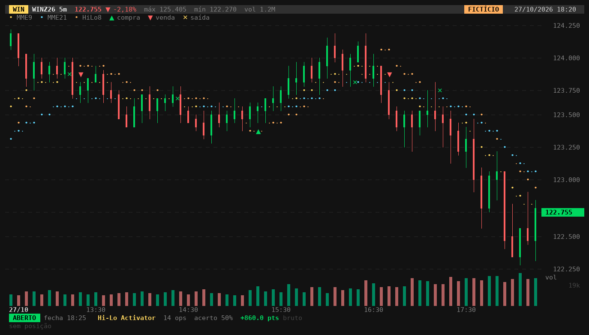

# b3-trader-skill

Skills do Claude para operar a B3 com método, começando pelo **mini índice
(WIN)** e pelo **mini dólar (WDO)**: regras dos contratos, dados de 1 a 60
minutos, seis estratégias com sinais simulados, um **scanner de setups**, uma
**máquina do tempo** que simula o seu plano em 10.000 pregões e um **gráfico de
velas colorido no terminal**, com painel no tmux.



Gratuito, MIT, sem cadastro e sem chave de API. As ferramentas são scripts
Python simples (só a biblioteca padrão), e o Claude roda esses scripts em vez de
fazer conta de cabeça.

**Este pacote não envia ordens.** Ele cuida das regras, dos dados, dos sinais e
da visualização. A execução fica com uma plataforma da sua corretora (por
exemplo, um robô no MetaTrader 5), sob o seu controle.

> Versão 0.3. Seis skills prontas. Os dados de teste (mock) deixam rodar tudo
> antes de ter uma fonte real. Veja o [roteiro](#roteiro).

## As skills

| comando | o que faz |
| --- | --- |
| `/b3-contratos` | Contrato vigente (WINZ26, WDOX26...), vencimento, rolagem, pregão aberto ou fechado, feriados da B3 e quanto vale uma variação de pontos em reais. |
| `/b3-dados` | Candles de WIN e WDO em 1, 5, 15, 30 e 60 min num formato único: dados fictícios para teste, importação do MetaTrader 5 e do Profit, leitura do MT5 ao vivo, validação e série contínua. |
| `/b3-sinais` | Seis estratégias (rompimento da abertura, Setup 9.1, cruzamento de médias, VWAP, IFR2, Hi-Lo) com entrada, stop, alvo, zeragem do dia e resultado bruto em pontos e reais. Compara as estratégias lado a lado. |
| `/b3-scanner` | Varre WIN e WDO no diário e em 5, 15 e 60 min e lista os setups do último candle fechado, para os dois lados: rompimento de N candles, bandeira, retomada da média, IFR no extremo, repique, rompimento da abertura do dia e a situação das seis estratégias. |
| `/b3-timemachine` | Simula um plano (entrada, stop, alvo) em 10.000 pregões montados com os candles reais do ativo, sorteados pelo horário do dia: chance de alvo antes do stop, preço provável no fim, resultado médio em R e em reais, o mesmo plano nos pregões reais e um veredito. |
| `/b3-grafico` | Gráfico de velas no terminal com volume, médias, VWAP, Hi-Lo, as entradas e saídas da estratégia e o stop e alvo da posição. Ao vivo, em replay ou como imagem. Painel completo no tmux. |

Pergunte em português normal. Por exemplo:

- "Qual o contrato do mini índice hoje e quando eu rolo?"
- "Gera 3 meses de dados de teste do WDO."
- "Compara as estratégias no WIN de 15 minutos."
- "Roda o Setup 9.1 no dólar só comprado e com validade de 3 candles."
- "O que tem de setup agora no WIN e no WDO?"
- "Comprei o WIN em 130.200 com stop de 300 pontos. Qual a chance de bater 2R até as 17:55?"
- "Pega a ordem armada do Setup 9.1 e roda na máquina do tempo."
- "Abre o painel no tmux em modo demo."
- "Me mostra o gráfico de hoje do WIN com o Hi-Lo."

## Instalar

### No Claude Code, como plugin

```
/plugin marketplace add Carlosvpm/b3-trader-skill
/plugin install b3-trader-skill@b3-trader-skill
```

Como plugin, as skills aparecem com prefixo: `/b3-trader-skill:b3-sinais`.

### No Claude Code, copiando as pastas

Para ter `/b3-sinais` e as outras sem prefixo:

```bash
git clone https://github.com/Carlosvpm/b3-trader-skill.git
cp -r b3-trader-skill/b3-* ~/.claude/skills/
```

Só para um projeto: copie as mesmas pastas para `.claude/skills/` dentro do
repositório do projeto.

**Copie sempre todas juntas.** Cada uma usa a anterior
(`contratos` → `dados` → `sinais` → `scanner`, `timemachine` e `grafico`) e
procura por ela na pasta ao lado.

### No app do Claude

Cole isto numa conversa:

```
https://github.com/Carlosvpm/b3-trader-skill

install skill
```

### Requisitos

- Python 3.8 ou mais novo. Nada obrigatório para instalar com pip.
- Para o painel: `tmux` (Linux e macOS; no Windows, pelo WSL).
- Para puxar dados do MetaTrader 5: o terminal aberto e logado na corretora e,
  no Windows, `pip install MetaTrader5`; no Linux, o MT5 no Wine e
  `pip install mt5linux==1.0.11` (veja abaixo).
- Para exportar o gráfico em PNG: `pip install Pillow` (opcional; SVG não precisa).

## Começo rápido, com dados de teste

Tudo o que as skills gravam fica numa pasta `b3/` no diretório onde você está.

```bash
# 1. dados fictícios de WIN e WDO, em 1, 5, 15, 30 e 60 min
python3 b3-dados/dados.py mock WIN --de 2026-08-03 --ate 2026-10-27
python3 b3-dados/dados.py mock WDO --de 2026-08-03 --ate 2026-10-27

# 2. as seis estratégias lado a lado
python3 b3-sinais/sinais.py comparar b3/dados/WIN_5m.csv

# 3. os setups no último candle, como estavam às 10:15 do último dia
python3 b3-scanner/scanner.py --agora "2026-10-27 10:15"

# 4. a máquina do tempo para uma compra com stop de 300 pontos e alvo de 2R
python3 b3-timemachine/timemachine.py b3/dados/WIN_5m.csv --lado compra --stop-pontos 300 --rr 2 \
    --data 2026-10-27 --hora 10:15

# 5. um gráfico no terminal
python3 b3-grafico/grafico.py b3/dados/WIN_5m.csv -e hilo --hilo 8 --dias 1

# 6. o painel completo
b3-grafico/painel.sh demo
```

**Os dados `mock` são fictícios.** A coluna `fonte` diz `mock`, os gráficos
mostram o selo `FICTÍCIO` e os relatórios avisam. Servem para testar o fluxo,
nunca para escolher estratégia.

## O gráfico e o painel



- Velas verdes e vermelhas com meia linha de resolução, alinhadas à direita.
- MME 9 e 21, VWAP e Hi-Lo por cima das velas, volume embaixo.
- ▲ compra, ▼ venda, ✕ saída da estratégia escolhida; linhas de entrada,
  stop e alvo da posição aberta, com rótulo na escala.
- Cabeçalho com contrato, preço, variação do dia, máxima, mínima e volume;
  rodapé com o pregão (aberto ou fechado) e o resumo da estratégia.

```bash
python3 b3-grafico/grafico.py b3/dados/WIN_1m.csv --tf 5 -e setup_9_1 --vwap   # uma vez
python3 b3-grafico/grafico.py b3/dados/WIN_1m.csv --tf 5 --replay 0.3 -e vwap   # replay
python3 b3-grafico/grafico.py b3/dados/WIN_1m_aovivo.csv --tf 5 --seguir 1      # ao vivo
python3 b3-grafico/grafico.py b3/dados/WIN_5m.csv --dias 1 --png win.png        # imagem
```

`b3-grafico/painel.sh` monta a sessão `b3` no tmux:

1. **principal**: WIN e WDO no tempo gráfico escolhido e uma coluna com preço,
   pregão, contrato, rolagem, a situação das seis estratégias e os eventos do dia.
2. **1min**: WIN e WDO em 1 minuto.
3. **estrategias**: a comparação das estratégias, atualizada a cada minuto.

```bash
b3-grafico/painel.sh demo                          # replay dos dados fictícios
b3-grafico/painel.sh aovivo --tf 5 -e setup_9_1    # com o MT5 alimentando
b3-grafico/painel.sh arquivo --tf 15 -e vwap       # redesenha os arquivos de b3/dados
```

No tmux: `Ctrl+b` e depois `1`, `2` ou `3` troca de janela; `Ctrl+b d` sai e
deixa rodando; `tmux attach -t b3` volta; `tmux kill-session -t =b3` fecha.

## As estratégias

| nome | entrada | stop | saída |
| --- | --- | --- | --- |
| `rompimento_abertura` | candle fecha fora da faixa dos primeiros 15 min | outro lado da faixa | alvo de 2 vezes o risco |
| `setup_9_1` | MME9 vira: ordem stop além do candle que virou | outro extremo desse candle | MME9 vira contra |
| `cruzamento_medias` | MME9 cruza a MME21 | extremo dos últimos 5 candles | cruzamento contrário |
| `vwap` | candle fecha cruzando a VWAP do dia | extremo dos últimos 3 candles | fecha do outro lado |
| `ifr2` | IFR de 2 períodos abaixo de 25 | sem stop de preço | máxima dos 2 últimos candles, ou 7 candles |
| `hilo` | Hi-Lo vira | linha do Hi-Lo, móvel | Hi-Lo vira contra |

Todas as regras são parâmetros: `-p nome=valor` na linha de comando ou
`b3/estrategias.json` (modelo em `b3-sinais/estrategias.example.json`).

A simulação é a mesma para todas: sinal no fechamento do candle, entrada no
candle seguinte, stop conta antes do alvo quando os dois cabem no mesmo candle,
sem entrada depois das 17:30, posição zerada às 17:55 e resultado **bruto**,
sem custos. Um teste garante que nenhuma estratégia olha para o futuro.

## O scanner

```bash
python3 b3-scanner/scanner.py                         # WIN e WDO, diário + 5, 15 e 60 min
python3 b3-scanner/scanner.py --aovivo --tfs 5,15     # com o MT5 alimentando
python3 b3-scanner/scanner.py --setups rompimento,orb -p rompimento_n=30
python3 b3-scanner/scanner.py listar
```

| setup | alta | baixa |
| --- | --- | --- |
| `rompimento` | fecha acima da máxima dos 20 candles anteriores | fecha abaixo da mínima |
| `bandeira` | mastro de 3 ATRs, depois 5 candles apertados sem devolver metade | o espelho |
| `retomada_media` | volta acima da média de 20 | perde a média |
| `ifr_extremo` | IFR14 abaixo de 30 | acima de 70 |
| `repique` | IFR estava abaixo de 30 e fechou subindo | acima de 70 e fechou caindo |
| `orb` | candle de 5 min fecha acima da faixa dos primeiros 15 min de hoje | fecha abaixo |
| `estrategias` | posição, ordem armada, sinal ou saída de cada estratégia da `b3-sinais` | |

Só conta o **último candle fechado**: o candle em formação fica de fora, e o
diário só entra com o pregão completo. `--agora "AAAA-MM-DD HH:MM"` revê um
momento do passado sem olhar o futuro. Se o pregão está aberto e o dado parou,
ele avisa. A lista vai para `b3/scanner/varredura.json` e, quando o setup tem
stop, vem com a linha pronta para a máquina do tempo.

## A máquina do tempo

```bash
python3 b3-timemachine/timemachine.py b3/dados/WIN_5m.csv --lado venda --entrada 130250 \
    --stop 130500 --alvo 129800 --data 2026-10-30 --hora 10:30
python3 b3-timemachine/timemachine.py b3/dados/WIN_5m.csv --de-sinal b3/sinais/WIN_5m_setup_9_1.json
```

Pega os últimos 60 pregões completos antes do dia do plano, guarda cada candle
como razões do fechamento anterior e monta 10.000 pregões novos sorteando, para
cada horário, um candle real do mesmo horário (± 2 candles). Conta stop antes
do alvo no mesmo candle e sai no preço do gap quando o stop é pulado.
Mostra:

- alvo primeiro, stop primeiro, nenhum até as 17:55 e quantos terminaram no verde;
- o preço provável às 17:55 (mediana e faixa de 90%);
- o resultado médio em R, em pontos e em reais por contrato (bruto);
- o mesmo plano nos 60 pregões reais, entrando no mesmo horário;
- um veredito: a chance de alvo antes do stop contra o empate de 1 em (1 + RR).

A semente é fixa, então o mesmo plano dá o mesmo número. `--gravar` salva o
leque de preços, 160 caminhos e o histograma em `b3/timemachine/`.

## Dados reais pelo MetaTrader 5

O MetaTrader 5 é gratuito em várias corretoras (na XP, ative em Plataformas).
Ele roda no Windows ou no Linux.

### No Linux (tudo numa máquina só)

O terminal roda no Wine, pelo instalador oficial da MetaQuotes, e a ponte
[mt5linux](https://github.com/lucas-campagna/mt5linux) deixa o Python do Linux falar com ele.

```bash
# 1. MT5 no Wine (Ubuntu, Debian, Mint, Fedora)
wget https://download.terminal.free/cdn/web/metaquotes.software.corp/mt5/mt5linux.sh
chmod +x mt5linux.sh && ./mt5linux.sh
# abra o MT5, faça login na conta da corretora e deixe aberto

# 2. a ponte: baixe o mt5server.exe em github.com/lucas-campagna/mt5linux/releases
WINEPREFIX=~/.mt5 wine mt5server.exe --host 127.0.0.1 -p 18812   # deixe rodando num painel do tmux

# 3. no Python do Linux (venv, porque Ubuntu e Mint recusam pip no sistema)
python3 -m venv .venv
.venv/bin/pip install mt5linux==1.0.11
.venv/bin/python b3-dados/mt5.py simbolo WIN
.venv/bin/python b3-dados/mt5.py exportar WIN --de 2026-09-01
.venv/bin/python b3-dados/mt5.py ao-vivo WIN
```

**Fixe a versão 1.0.11 do mt5linux.** Da 1.1 em diante o cliente ignora o
`mt5server.exe` e, sem avisar, baixa a imagem Docker `lprett/mt5linux` e sobe
um contêiner com outro MT5, que não está logado na sua conta. O `mt5.py` recusa
essas versões. O `--host 127.0.0.1` deixa a ponte só na sua máquina.

O `mt5.py` usa a ponte sozinho quando o pacote oficial não está instalado.
Para um MT5 em outra máquina, use `--host` e `--porta` (ou `B3_MT5_HOST` e
`B3_MT5_PORTA`).

### No Windows

Com o terminal MT5 aberto e logado:

```bash
pip install MetaTrader5
python b3-dados/mt5.py simbolo WIN                    # qual código pedir hoje
python b3-dados/mt5.py exportar WIN --de 2026-09-01   # histórico de 1 min, já em 5/15/30/60
python b3-dados/mt5.py ao-vivo WIN                    # grava os candles conforme fecham
```

O `ao-vivo` mantém `b3/dados/WIN_1m_aovivo.csv` (candles fechados) e
`b3/estado/WIN_ultimo.json` (último preço, bid, ask e o candle em formação). O
símbolo sai da regra de rolagem, então você não troca `WINZ26` por `WING27` na
mão. Para a série contínua da corretora, passe `--simbolo 'WIN$N'`. O script só
lê cotações e nunca envia ordem.

**MT5 no Windows e painel no WSL**: rode o `mt5.py ao-vivo` no Windows, na
pasta do projeto, e o `painel.sh aovivo` no WSL, na mesma pasta (por exemplo
`/mnt/c/Users/voce/projeto`). Os dois conversam pelos arquivos de `b3/`.

**MT5 num Windows e você no Linux, em outra máquina**: rode o `mt5server.exe`
da ponte no Windows (ele também roda nativo, sem Wine) e no Linux use
`mt5.py ao-vivo WIN --host IP_DO_WINDOWS`.

Também dá para importar o que você exportar à mão:

```bash
python3 b3-dados/dados.py importar export_mt5.csv --ativo WIN --tfs 1,5,15,30,60
python3 b3-dados/dados.py importar export_profit.csv --ativo WDO --formato profit
```

## Formatos

Candles (`b3/dados/WIN_5m.csv`):

```
data_hora,ativo,contrato,abertura,maxima,minima,fechamento,volume,fonte
2026-10-27 09:00,WIN,WINZ26,130125,130210,130090,130180,1834,mt5
```

Horário de Brasília, `data_hora` é o início do candle, e os candles de 5 a 60
min começam na abertura do pregão e nunca juntam dois dias.

Sinais (`b3/sinais/WIN_5m_setup_9_1.json`): as operações (entrada, stop,
alvo, saída, pontos, reais), a posição aberta, a ordem pendente e o resumo.

## As regras de mercado

| | WIN | WDO |
| --- | --- | --- |
| valor do ponto | R$ 0,20 | R$ 10,00 |
| tick | 5 pontos (R$ 1,00) | 0,5 ponto (R$ 5,00) |
| vencimentos | meses pares | todo mês |
| vence | quarta-feira mais próxima do dia 15 | primeiro dia útil do mês |
| último dia de negociação | o vencimento | último dia útil do mês anterior |
| horário (desde 09/03/2026) | 09:00 às 18:25 | 09:00 às 18:30 |
| rolagem (regra prática) | 2 dias úteis antes do último dia | 2 dias úteis antes do último dia |

O calendário de 2026 é a lista oficial da B3; outros anos são calculados e
marcados assim. A B3 muda o horário algumas vezes por ano: ajuste em
`b3/config.json` (modelo em `b3-contratos/config.example.json`).

## Como o pacote foi pensado

- **Uma skill para cada tarefa.** Cada uma lê o que a anterior gravou em `b3/`.
- **Conta é feita por script, nunca de cabeça.** Vencimento, feriado, tick,
  sinal e valor em reais saem de código testado.
- **Formato único entre as etapas.** É ele que vai servir de ponte para o executor.
- **Testes offline.** `python3 -m unittest discover -s tests -v`.
- **Dado fictício é sempre marcado como fictício.**

## Roteiro

```
contratos -> dados -> sinais -> scanner / timemachine / grafico
                         \-> backtest -> risco -> ponte -> (robô na sua plataforma)
```

| skill | situação | o que faz |
| --- | --- | --- |
| `b3-contratos` | pronta | regras, calendário, rolagem e valor do ponto |
| `b3-dados` | pronta | mock, importação, MT5, validação e série contínua |
| `b3-sinais` | pronta | seis estratégias, sinais e resultado bruto |
| `b3-scanner` | pronta | setups no último candle, nos dois lados, em vários tempos gráficos |
| `b3-timemachine` | pronta | o seu plano em 10.000 pregões simulados e nos pregões reais |
| `b3-grafico` | pronta | velas no terminal, replay, ao vivo e painel no tmux |
| `b3-backtest` | planejada | resultado líquido com corretagem, emolumentos e slippage, por período |
| `b3-risco` | planejada | perda máxima no dia, limite de contratos, janela de horário e margem |
| `b3-ponte` | planejada | grava o sinal aprovado num arquivo que um robô do MT5 lê e executa, com você no controle |
| ações da B3 | depois | reaproveitar dados, sinais, gráfico, risco e ponte no mercado à vista |

## Contribuir

Issues e pull requests são bem-vindos. Antes de abrir um PR:

- rode os testes (`python3 -m unittest discover -s tests -v`);
- mantenha as skills só com a biblioteca padrão (MetaTrader5 e Pillow são opcionais);
- toda regra nova de mercado precisa de teste e de fonte (página ou ofício da B3);
- estratégia nova: uma classe em `b3-sinais/sinais.py`, com fonte e parâmetros,
  e ela precisa passar no teste que proíbe olhar o futuro.

`tools/captura_tmux.py` fotografa uma janela do tmux em PNG (foi assim que as
imagens deste README foram feitas).

## Avisos

**Não é recomendação de investimento.** É software que aplica regras e faz
contas. Ele não conhece a sua situação e não prevê o mercado.

**Resultado simulado não é resultado real.** O resultado das estratégias é
bruto, sem custos, e com dados fictícios não quer dizer nada.

**Futuros são alavancados.** No mini dólar, 10 pontos valem R$ 100 por
contrato. Você pode perder mais do que a margem depositada.

**Não envia ordens.** Nenhuma skill deste pacote fala com a corretora para
operar. Quando existir a ponte para um robô, comece em conta de simulação.

**Confira as regras.** Horários e feriados mudam. Confirme no site da B3 e na sua
corretora antes de operar.

## Arquivos

```
b3-contratos/    SKILL.md, contratos.py, config.example.json
b3-dados/        SKILL.md, dados.py, mt5.py
b3-sinais/       SKILL.md, sinais.py, indicadores.py, estrategias.example.json
b3-scanner/      SKILL.md, scanner.py
b3-timemachine/  SKILL.md, timemachine.py
b3-grafico/      SKILL.md, grafico.py, painel.py, painel.sh, tela.py
tests/           testes unittest + exemplos de exportação do MT5 e do Profit
tools/           captura_tmux.py (imagens do README)
docs/            imagens
.claude-plugin/  manifesto do plugin para o Claude Code
```

Inspirado na estrutura do [trader-skill](https://github.com/Jakeschincariol/trader-skill);
o scanner e a máquina do tempo partem das ideias do
[day-trader-skill](https://github.com/Jakeschincariol/day-trader-skill), adaptadas
para futuros da B3.
MIT. Feito por [Carlosvpm](https://github.com/Carlosvpm).
